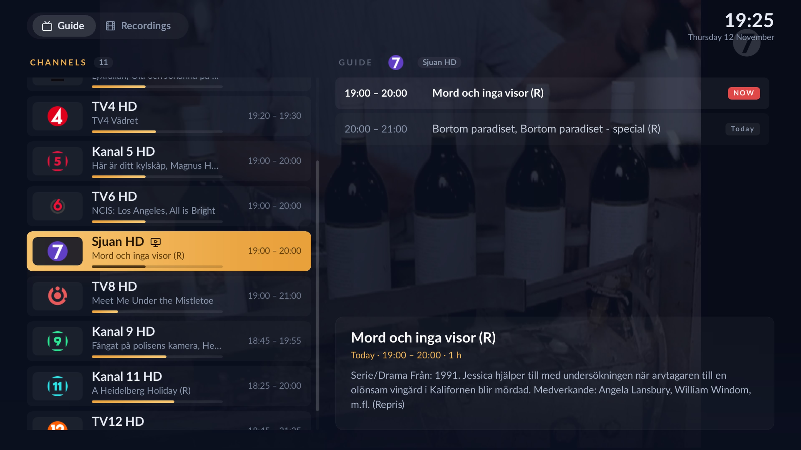

# tvhp

A [Tvheadend](https://tvheadend.org/) client for jailbroken PlayStation 4
consoles where the majority of the source code was generated by Claude.ai
(including this readme).

It speaks HTSP directly — no transcoding proxy, no browser — and plays
the stream with libmpv, so live TV and recordings play from the same
connection that carries the channel list and the guide.

## Features

- **Live TV** — channel list with now/next and a progress bar, full programme
  guide per channel, full-screen playback with channel zapping.
- **Scheduling** — record any programme from the guide with one button.
- **Recordings** — browse everything the DVR holds, play it back, and cancel
  or delete entries.
- **Playback of recordings over HTSP**, using the server's file API, including
  recordings that are still running.
- **Resume where you left off** — the position is kept by Tvheadend itself
  (HTSP 27+), so it is shared with Kodi and every other client. The list shows
  how far each recording got and which have been watched.
- **Playback menu** (Options while watching) — audio track, subtitles, speed,
  picture fit, audio and subtitle delay, subtitle size, sleep timer
  (live TV can sleep at the end of the programme on air).
- **DVB subtitles on live TV and recordings.** A language you pick stays picked
  from channel to channel, as does turning them off.
- Seek steps that grow while you keep pressing (10 s → 30 s → 1 min → 5 min),
  "ends at" for recordings, and the tracks being played on the info bar.
- **Video behind the menus**, as in Kodi — Back from full screen brings the
  guide or the recordings up over the picture, which plays on behind them.
  Back again, or selecting what plays, returns to it. Back never stops
  playback or disconnects; Stop and Options → Stop do.
- **Channel logos** — Tvheadend's own, in the channel list, the guide, the
  recordings and the player, kept on the console after the first time. With
  the server's image cache on, they come over the HTSP connection (`fileOpen`);
  with it off (Tvheadend's default) the server gives their web addresses, which
  are fetched over http(s), with the server's login when they are on its own
  host.
- **Multiple servers** — save as many as you like and switch between them
  without restarting. `tvhp` connects to the last one used by itself, and
  when the connection drops it connects again, with the channel that was on.
- Designed for a 1920x1080 screen at couch distance: large type, high
  contrast, and a single unmistakable focus colour. The look is jtplay's —
  rounded rows, an amber focus bar, soft shadows, glass dialogs, Lucide icons —
  which takes the GPU (Mesa over Vulkan on the console).

## Controls

As on the PS4's own screens there are no button hints: Cross selects, Circle
goes back, and the **Options** button opens a menu, on the right, with what can
be done with what is selected — record or cancel a recording, play from where it
was left or from the start, mark as watched, delete (after asking), edit or
delete a server, switch server. While something plays, Options opens the
playback settings instead. Square and Triangle are kept as shortcuts.

`tvhp` can be driven from a game controller (the DualShock 4 on a PS4, any pad
SDL knows on a PC), from a remote control or multimedia keyboard, or from an
ordinary keyboard. All of them meet in one table (`src/keymap.h`), so every
command is reachable from any of them; the pad mapping lives in
`src/gamepad.cpp`.

| Command | Pad | Remote | Keyboard |
| --- | --- | --- | --- |
| Navigate | D-pad, left stick (held: repeats) | D-pad | Arrows |
| Guide / Recordings tabs | Up from the top of a list, then Left / Right; or L1 / R1 | Up, then Left / Right | Up, then Left / Right |
| While watching: previous / next channel, or 5 min back / on | L1 / R1 | — | — |
| Page up / down | L2 / R2 | P+ / P- | Page Up / Page Down |
| First / last row | — | — | Home / End |
| Select: connect, watch, record, play; play/pause | Cross | Enter | Enter |
| What can be done with it (menu) | Options (or hold Cross) | Menu (or hold OK) | Insert (or hold Enter) |
| Back, cancel; from full screen: the menus, playing on | Circle | Back | Escape, Backspace |
| Back to full screen | Circle, or Cross on what plays | Back, Enter | Escape, Enter |
| Guide ↔ recordings, info bar | Square | Display | Tab |
| Delete recording or server (asks) | Triangle | Red | Delete |
| Next audio track | — | Audio | F2 |
| Jump to the guide | Back/select (not on a PS4) | Guide | F9 |
| Play / pause | Cross | Play, Pause | Space |
| Stop | Options → Stop | Stop | — |
| Seek ±10 s, growing while pressed | Left / Right | Rewind, Fast forward | Left / Right |
| Seek ±5 min | Up / Down, L1 / R1, L2 / R2 | Skip, P+ / P- | Page Up / Page Down |

The key identifiers follow what remote controls send, and the pad is mapped
onto them rather than the other way round. That is why Circle is Escape rather
than Backspace, and why Square is Tab rather than Space: a remote's back button
sends Escape, and its play/pause button sends Space.

## Requirements

- A jailbroken PS4 that installs fake packages (`.pkg`).
- A Tvheadend server reachable on your network, with an HTSP user. The default
  HTSP port is 9982.
- HTSP protocol version 8 or later for recording playback. `tvhp` announces
  version 35; anything Tvheadend 4.2 or newer is comfortably sufficient.

## Install

Download `IV0000-BREW04328_00-TVHP000000000000.pkg` from the
[releases page][releases] (or build it, below) and install it with your
package installer. `TVHP` then appears on the home screen.

The package is a non-game application (param.sfo category `gdc`), as jtplay
is: a PS5 running it treats it as a media app, which is what gets it the
remote's media keys. Its data is in the title's download data, `/download0`
(128 MiB), where SDL2main puts the XDG base directories: the saved servers and
player settings in `/download0/.data/tvhp/tvhp.cfg`, the channel logos in
`/download0/.cache/tvhp/icons/`, Mesa's shader cache beside them. This needs
the ps4-homebrew-dev SDK 0.8.7 or later (its SDL2main patch
`0006-ps4-SDL2main-the-XDG-base-directories-in-download0`); built with an
older one, they end up in `common_temp`, which all homebrew shares. Where they
went is printed at startup (`tvhp: servers in ...`).

Versions before this one were packaged as a game and kept the servers in
`/temp0`, which a non-game cannot reach: add your server again once after
updating.

[releases]: ../../releases

## Playback

Playback is libmpv's: mpv decodes and plays the audio, and draws the video
with its OpenGL renderer under the UI. Everything still comes over the one
HTSP connection, which mpv reads through two stream protocols of tvhp's own
(`src/player.cpp`):

- a live channel arrives as elementary-stream packets, which are put back
  into an MPEG transport stream with libavformat's muxer (`src/tsmux.cpp`)
  and read by mpv as `tvhp-live://`;
- a recording is read with HTSP's `fileOpen`/`fileRead` as `tvhp-dvr://`,
  with seeking. At the end of a recording that is still running, playback
  waits for more instead of stopping.

Live channels carry their DVB subtitles into the transport stream as well.
Teletext subtitles are left out: decoding them needs an FFmpeg built with
libzvbi.

The playback menu's settings, and the audio and subtitle languages last picked,
are kept in `tvhp.cfg` with the servers (`player.*` keys). The languages work
as mpv's `alang`/`slang`: a subtitle track in the remembered language is
switched on by itself when a channel starts.

Extra mpv options can be given for testing or tuning, and mpv's log made more
verbose:

    TVHP_MPV="hwdec=auto-safe alang=deu" TVHP_MPV_LOG=v ./tvhp

## Building

Besides SDL2, RmlUi (6.2) and SDL2_image, the build needs libmpv and
libavformat. On a PC:

    cmake -S . -B build && cmake --build build
    ./build/tvhp

Without arguments `tvhp` looks for `assets/` and `fonts/` in the working
directory and keeps its servers in `tvhp.cfg` there; `tvhp --help` lists the
options that change that. The `TVH_HOST`, `TVH_PORT`, `TVH_USER` and
`TVH_PASS` environment variables preset a server.

For the PS4, with the ps4-homebrew-dev SDK, the same CMakeLists.txt builds
`build-ps4/IV0000-BREW04328_00-TVHP000000000000.pkg`:

    source $PS4_HOMEBREW_SDK/toolchain/orbis.sh
    cmake -S . -B build-ps4 -DCMAKE_TOOLCHAIN_FILE=$PS4_HOMEBREW_SDK/toolchain/orbis.cmake
    cmake --build build-ps4

## Known limitations

- Logos given as `picon://` (picons without a picon folder set on the server)
  cannot be fetched; those channels show their number instead. Set the picon path
  in Tvheadend (Configuration → General → Base) and they come as files.
- Only programme-based recording: no manual time ranges.
- No series recording: `autorec` and `timerec` rules are neither listed nor
  editable.
- No transcoding profile selection; the server's default is used.
- No teletext subtitles (see Playback).
- Switching the audio track on live TV can leave a few seconds of silence:
  the new track joins where mpv is reading, slightly ahead of the picture.
