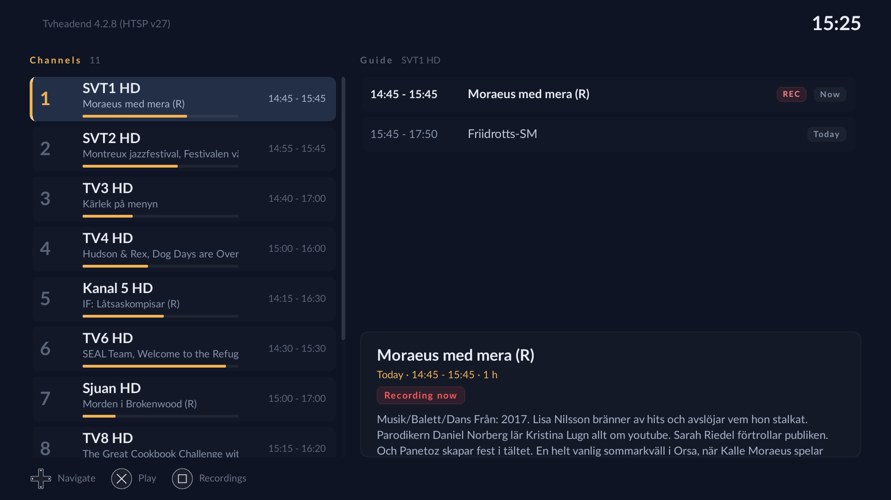

# tvhp

A [Tvheadend](https://tvheadend.org/) client for jailbroken PlayStation 4
consoles where the majority of the source code was generated by Claude.ai
(including this readme).

It speaks HTSP directly — no transcoding proxy, no browser — and plays
the stream with libmpv, so live TV and recordings play from the same
connection that carries the channel list and the guide.

## Features

- **Live TV** — channel list with now/next and a progress bar, full programme
  guide per channel, full-screen playback with channel zapping.
- **Scheduling** — record any programme from the guide with one button
- **Recordings** — browse everything the DVR holds, play it back, and cancel
  or delete entries.
- **Playback of recordings over HTSP**, using the server's file API, including
  recordings that are still running.
- **Multiple servers** — save as many as you like and switch between them
  without restarting.
- Designed for a 1920x1080 screen at couch distance: large type, high
  contrast, and a single unmistakable focus colour.

## Controls

`tvhp` can be driven from a game controller (the DualShock 4 on a PS4, any pad
SDL knows on a PC), from a remote control or multimedia keyboard, or from an
ordinary keyboard. All of them meet in one table (`src/keymap.h`), so every
command is reachable from any of them; the pad mapping lives in
`src/gamepad.cpp`.

| Command | Pad | Remote | Keyboard |
| --- | --- | --- | --- |
| Navigate | D-pad, left stick (held: repeats) | D-pad | Arrows |
| Page up / down | L1 / R1 | P+ / P- | Page Up / Page Down |
| First / last row | L2 / R2 | — | Home / End |
| Select, record, play/pause | Cross | Enter | Enter |
| Back, cancel | Circle | Back | Escape, Backspace |
| Guide ↔ recordings, info bar | Square | Display | Tab |
| Delete recording or server | Triangle | Red | Delete |
| Add a server | Options | Menu | Insert |
| Jump to the guide | Back/select (not on a PS4) | Guide | F9 |
| Play / pause | Cross | Play, Pause | Space |
| Stop | Circle | Stop | — |
| Seek ±5 min | Up / Down | Rewind, Fast forward | — |
| Seek ±30 s | Left / Right | — | Left / Right |

The key identifiers follow what remote controls send, and the pad is mapped
onto them rather than the other way round. That is why Circle is Escape rather
than Backspace, and why Square is Tab rather than Space: a remote's back button
sends Escape, and its play/pause button sends Space.

## Requirements

- A jailbroken PS4 that installs fake packages (`.pkg`).
- A Tvheadend server reachable on your network, with an HTSP user. The default
  HTSP port is 9982.
- HTSP protocol version 8 or later for recording playback. `tvhp` announces
  version 35; anything Tvheadend 4.2 or newer is comfortably sufficient.

## Install

Download `IV0000-BREW04328_00-TVHP000000000000.pkg` from the
[releases page][releases] (or build it, below) and install it with your
package installer. `TVHP` then appears on the home screen.

The saved servers are kept in `/data/tvhp/tvhp.cfg`.

[releases]: ../../releases

## Playback

Playback is libmpv's: mpv decodes and plays the audio, and draws the video
with its OpenGL renderer under the UI. Everything still comes over the one
HTSP connection, which mpv reads through two stream protocols of tvhp's own
(`src/player.cpp`):

- a live channel arrives as elementary-stream packets, which are put back
  into an MPEG transport stream with libavformat's muxer (`src/tsmux.cpp`)
  and read by mpv as `tvhp-live://`;
- a recording is read with HTSP's `fileOpen`/`fileRead` as `tvhp-dvr://`,
  with seeking. At the end of a recording that is still running, playback
  waits for more instead of stopping.

Extra mpv options can be given for testing or tuning, and mpv's log made more
verbose:

    TVHP_MPV="hwdec=auto-safe alang=deu" TVHP_MPV_LOG=v ./tvhp

## Building

Besides SDL2, RmlUi (6.2) and SDL2_image, the build needs libmpv and
libavformat. On a PC:

    cmake -S . -B build && cmake --build build
    ./build/tvhp

Without arguments `tvhp` looks for `assets/` and `fonts/` in the working
directory and keeps its servers in `tvhp.cfg` there; `tvhp --help` lists the
options that change that. The `TVH_HOST`, `TVH_PORT`, `TVH_USER` and
`TVH_PASS` environment variables preset a server.

For the PS4, with the ps4-homebrew-dev SDK, the same CMakeLists.txt builds
`build-ps4/IV0000-BREW04328_00-TVHP000000000000.pkg`:

    source $PS4_HOMEBREW_SDK/toolchain/orbis.sh
    cmake -S . -B build-ps4 -DCMAKE_TOOLCHAIN_FILE=$PS4_HOMEBREW_SDK/toolchain/orbis.cmake
    cmake --build build-ps4

## Known limitations

- Channel icons are fetched from the server but not displayed yet.
- Only programme-based recording is exposed. The client can also schedule a
  manual time range (`HtspClient::RecordTimespan`), but nothing in the UI
  calls it.
- No series recording: `autorec` and `timerec` rules are neither listed nor
  editable.
- No transcoding profile selection; the server's default is used.
- No audio track or subtitle selection: mpv plays the first audio track (or
  the one `alang` picks), and DVB subtitles and teletext are left out.
